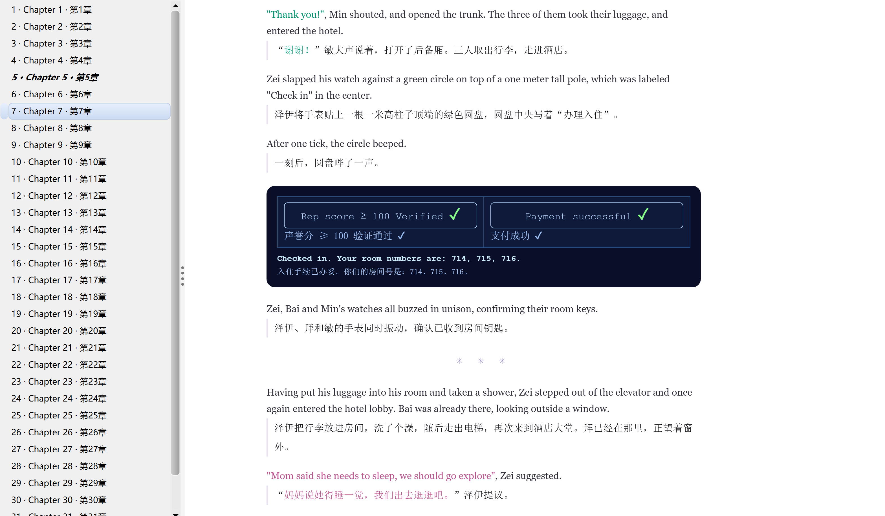

# Snowmoon 双语 EPUB

遵循 Vitalik 对《Snowmoon》衍生制作管线的开放要求，本仓库公开本次双语 EPUB 制作所使用的提示词、代码及必要源材料，供他人复现、修改和继续改进译本。

双语版覆盖全 32 章，英文在前、中文在后，保留原有图表、对白配色和设备面板。



## 项目结构

```text
snowmoon-bilingual-epub/
├── README.md
├── COPYING
├── pyproject.toml
├── uv.lock
├── inputs/                   # 固定英文快照、中文底稿、SVG 与来源清单
├── edits.json                # 采纳修订及必要的审校记录
├── release/                  # 本次制作的成品与修改意见表
│   ├── snowmoon-bilingual-full-ch01-32.epub
│   └── Snowmoon-翻译修改意见.xlsx
├── prompts/                  # 决策提示词与修订任务说明
├── workflow/                 # 决策、修订任务包、复评与意见表导出
└── book/
    ├── prepare_inputs.py     # 准备章节并应用修订
    ├── build_full.py         # 全书组装、转换与回读
    ├── render.py             # 中英段落、表格与面板渲染
    ├── style_base.css
    └── checks/image_layout.py
```

## 制作流程

安装 uv 和 Calibre，确认 `ebook-convert` 在 PATH 中，再安装锁定的 Python 依赖。本次制作使用 Calibre 9.9.0 和 Beautiful Soup 4.15.0。

```bash
uv sync --frozen
```

### 1. 准备章节

将固定英文快照与中文底稿按段落对齐，整理术语、译注和对应图示。命令同时应用 `edits.json` 中已采纳的正文、译注与 SVG 无障碍文本修订，工作文件写入 `work/`，原始输入保持不变。

```bash
uv run python book/prepare_inputs.py
```

### 2. 修订

重建现有版本可跳过本节，沿用仓库中的固定修订。开展新一轮审校时，使用 `workflow/` 中的脚本和 `prompts/` 中的任务说明，依次完成：

1. **决策环节**：将英文、当前中文、相邻段落与术语等上下文交给三个决策模型，经 OpenRouter Decisions 分别判断“这段中文是否存在需要纠正的实质语义错误”。各模型返回概率判断，用于定位错译、漏译、指代或数字等疑点。模型意见不一致的内容也交给后续核查。
2. **提出修订**：DeepSeek 结合上下文核查疑点，必要时查看相关章节，区分原文版本差异与实际误译。只对证据充分的问题提出最小修改，并说明依据，保留作者与译者的口吻。无法确认的问题留待审核。
3. **候选复评与采纳**：把具体修订候选送回决策环节，按同一问题复评一次。图中标签与 SVG 的隐藏 title/desc 使用各自对应的判据。主代理结合语义证据和复评结果决定采纳、保留原译或待审。

采纳的文字、译注及图示无障碍文本修订连同理由写入 `edits.json`。更新后重新运行准备命令，再生成 EPUB。新一轮审校需要 OpenRouter 凭据与调用预算，凭据配置见 `.env.example`。

新一轮审校的修改意见写入 `work/reviews/NN/opinions.json`，由 `workflow/export_opinions.py` 导出意见表。SVG 无障碍文本的原始值取自 `inputs/upstream/assets`，映射来自本章 `source.json` 的 `figures[].file` 与 `figures[].zh`。归档根默认 `inputs/upstream`，`--archive` 可改用其他目录。

### 3. 生成双语 EPUB

渲染器组织中英段落和图示，由 Calibre 转换为 EPUB，并回读检查章节顺序、文字、资源引用与元数据。输出写入 `output/`。

```bash
uv run python book/build_full.py --chapters-root work/chapters --output output
```

## 许可与致谢

原作、中文底稿及本仓库代码与校订按 GNU GPLv3 提供，许可全文见 `COPYING`。[1][2]

### 原作与中文译本

感谢 **Vitalik Buterin** 创作并开放《Snowmoon》。作者声明文字由本人撰写，Kimi K3 与 Qwen 3.8 Flash Next 辅助原作校对与网页制作。[1]

特别感谢 **XiaoHai67890/snowmoon-zh** 提供完整中文译本、图示与可编辑源稿，原译校署名为 **Codex（AI）**。[2] 本项目在其简体中文校订版 v1.1 基础上进行针对性修订和双语排版。英文使用 2026-10-23 网站快照，中文固定于提交 `55f9a20b383ee124eb3eeffd137844d4b45990d6`。输入来源与哈希见 `inputs/manifest.json`，原源包校验清单见 [3]。

### 本项目使用的模型

| 模型 | 用途 |
| --- | --- |
| GPT-6.1 Sol | 方案、审查、证据裁决与整合 |
| DeepSeek V4.1 Flash | 子代理核查、修订与代码实施 |
| TypeSafe Jev 1.14 | 决策环节：原译判断与候选复评 |
| OpenAI GPT-6 Luna Decisions | 决策环节：原译判断与候选复评 |
| Perplexity Decider Flash v1.2 | 决策环节：原译判断与候选复评 |

### 工具

- **Hermes Agent、OpenRouter**：任务编排与执行、模型调用。
- **Python、uv、Beautiful Soup、Calibre**：脚本运行、依赖管理、HTML 处理与 EPUB 转换。
- **PyMuPDF、openpyxl、Chromium 系浏览器**：提取 PDF 内嵌源包、导出修改意见表、核查 SVG 布局。

### 来源

[1] https://vitalik.eth.limo/snowmoon

[2] https://raw.githubusercontent.com/XiaoHai67890/snowmoon-zh/55f9a20b383ee124eb3eeffd137844d4b45990d6/README.md

[3] https://raw.githubusercontent.com/XiaoHai67890/snowmoon-zh/55f9a20b383ee124eb3eeffd137844d4b45990d6/SHA256SUMS
